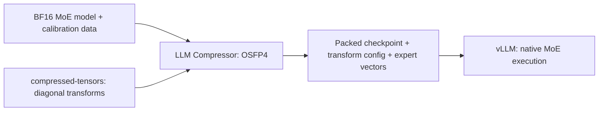

# OSFP4-MoE

A guide to calibrating, exporting, and serving OSFP4 Mixture-of-Experts models with three companion forks.

OSFP4 optimizes per-channel smoothing and FP4 quantization scales. The MoE integration extends this to individual experts: LLM Compressor calibrates and exports the model, compressed-tensors represents the diagonal input transforms, and vLLM applies those transforms during inference.

**Status: development integration.** The branches implement MoE calibration, checkpoint handling, and native serving paths. End-to-end MoE GPU accuracy and performance are not established by this repository. See the [support and validation status](docs/support.md) before choosing a deployment.

## The three forks

| Component | Use this branch | Responsibility |
|---|---|---|
| [LLM Compressor](https://github.com/orimeirgit/llm-compressor-for-osfp4/tree/add-moe-support) | `add-moe-support` | OSFP4 RTN/SIC optimization, MoE calibration, smoothing, and compressed checkpoint export |
| [compressed-tensors](https://github.com/orimeirgit/compressed-tensors-for-osfp4/tree/osfp4-diagonal-transform) | `osfp4-diagonal-transform` | Diagonal transform configuration, saved vectors, and transform-aware checkpoint representation |
| [vLLM](https://github.com/neriahbd/vllm-for-osfp4/tree/add-moe-support) | `add-moe-support` | Load expert vectors and apply them in native CUTLASS W4A4 or Humming W4A16 execution |

Use these branches together. Installing the stock packages alone does not establish support for this checkpoint contract. This repository contains documentation and a source checkout helper; the implementations remain in their respective forks.



## Start here

1. Read [how OSFP4 works for MoE](docs/moe.md).
2. Follow [setup, calibration, and serving](docs/getting-started.md).
3. Check the [supported configurations and validation gaps](docs/support.md).
4. Consult the [full integration design](docs/design.md) for numerical behavior, checkpoint details, component mapping, and reference results.

If you already have a compatible exported checkpoint, start with the serving section of the setup guide. If you are evaluating a new model architecture, verify its expert layout and calibration mappings first; generic MoE support in the underlying libraries is not a guarantee of OSFP4 support.

## Reproducible source snapshot

[revisions.tsv](revisions.tsv) records the three remote commit IDs checked on 2026-11-03. These are documentation reference revisions, **not a certified compatible release or a GPU-tested environment lock**.

To check out exactly those revisions:

```bash
bash scripts/checkout-forks.sh
```

The script creates `sources/` and stops if a destination already exists. Branch links above track ongoing development; commit IDs keep the documentation snapshot reproducible.

## What is different for MoE?

Each expert can have its own input-channel smoothing vector. Its gate and up projections share a vector because they consume the same input; its down projection has a separate vector. The checkpoint keeps those vectors under the original per-expert projection names. vLLM applies the selected expert's transform after routing and before the relevant quantized operation.

NVFP4 uses 4-bit weights and 4-bit activations (W4A4). NVFP4A16 uses 4-bit weights and 16-bit activations (W4A16). RTN and SIC are calibration/weight-quantization choices; they do not select the serving backend.

## Provenance and contributions

The full design is adapted from `osfp4-design-note-2.md`, with the repository targets changed to the MoE branches and MoE-specific behavior documented from their source. Dense-model reference results are kept explicitly separate from MoE validation.

Documentation was prepared with AI assistance. Corrections should identify the relevant fork, branch, and commit. Implementation issues belong in the responsible fork; cross-repository documentation fixes belong here. See [CONTRIBUTING.md](CONTRIBUTING.md).

The linked projects retain their own licenses and attribution. This repository does not redistribute their implementations or model weights.
